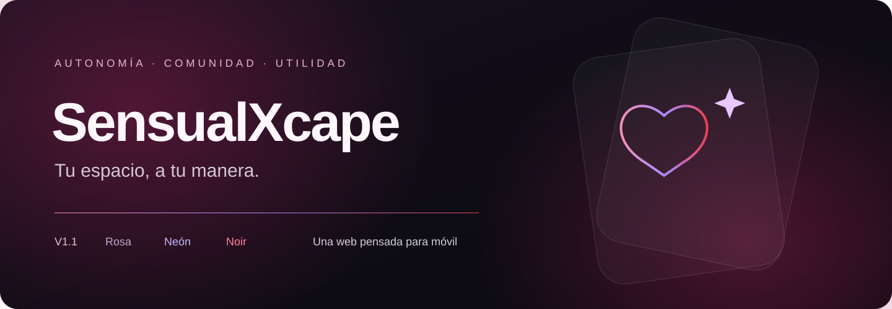
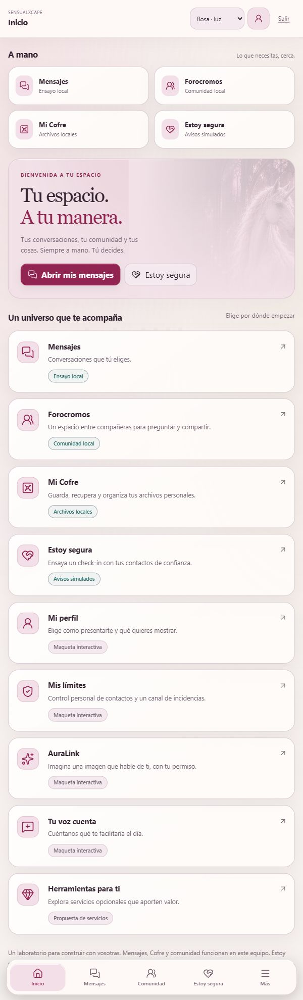
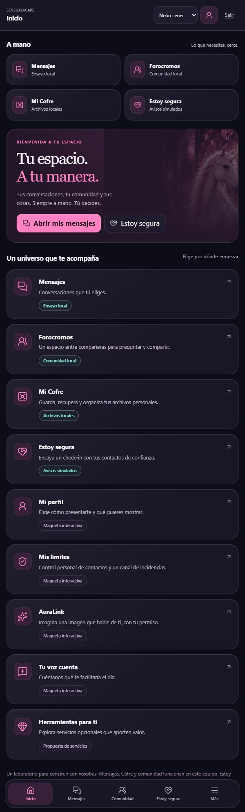
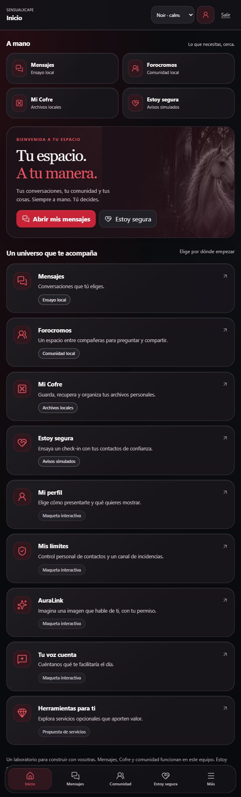

<p align="center">
  <a href="https://trece37.github.io/SensualXcape/"></a>
</p>

<h3 align="center">Un espacio propio. Conexiones que tú eliges. Herramientas que te sirven.</h3>

<p align="center">
  <a href="https://trece37.github.io/SensualXcape/v2/"><strong>✨ ABRIR SENSUALXCAPE V2</strong></a>
  &nbsp; · &nbsp; <a href="https://trece37.github.io/SensualXcape/foro/"><strong>Foro Cromos · comunidad privada</strong></a>
  &nbsp; · &nbsp; <a href="https://trece37.github.io/SensualXcape/demo/">Maqueta sin cuenta</a>
  &nbsp; · &nbsp; <a href="https://trece37.github.io/SensualXcape/">V1 original</a>
  &nbsp; · &nbsp; <a href="#tres-atmósferas-una-misma-experiencia">Ver los estilos</a>
  &nbsp; · &nbsp; <a href="docs/DESARROLLO.md">Guía de desarrollo</a>
</p>

<p align="center">
  <a href="https://github.com/trece37/SensualXcape/actions/workflows/pages.yml"></a>
  
  
  
</p>

---

## Un producto con un propósito

Foro Cromos añade una comunidad conectada a Supabase, con cuenta, admisión propia,
conversaciones persistentes, guardados y moderación. La interfaz está bajo `/foro/`;
V2 conecta cuentas, contactos, conversaciones y perfil a Supabase; la maqueta sin
cuenta se conserva en `/demo/` y la V1 original en la raíz. Consulta el
[alcance y estado del foro](docs/FORO_CROMOS.md) antes de abrir un piloto.

SensualXcape se construye para mujeres adultas que ejercen la prostitución: un espacio para organizarse, conectar entre compañeras y elegir qué compartir, con quién y cuándo. El producto parte de necesidades reales, autonomía y utilidad cotidiana.

Esta V1.1 reúne su identidad visual y sus recorridos en una web adaptable. En el teléfono encontrarás navegación al alcance del pulgar, accesos rápidos, conversaciones enfocadas y superficies de cristal con una presencia más cuidada.

**La web se publica en GitHub Pages y los servicios conectados usan Supabase.**
El piloto mantiene las cuentas existentes; las nuevas altas por correo siguen pendientes del servicio de envío.

> **Web conectada:** [V2](https://trece37.github.io/SensualXcape/v2/) y [Foro Cromos](https://trece37.github.io/SensualXcape/foro/) guardan sus datos reales. **Prueba sin cuenta:** [maqueta independiente](https://trece37.github.io/SensualXcape/demo/), con datos ficticios y cambios sólo en memoria.

## V2 conectada · 26/10/2026

La misma cuenta abre V2 y Foro Cromos. Mensajes permite invitaciones, solicitudes,
aceptación o rechazo, historial privado y bloqueo efectivo. Se conserva el historial
anterior de Connect. La admisión al foro se decide por separado.

Mi perfil guarda el borrador, hasta seis fotos, su orden y encuadre. Compartir crea
una copia separada para contactos aceptados y sin bloqueos; no hay directorio público.
Las fotos se normalizan a WebP de hasta 950 KB y se descargan con sesión autenticada.
El perfil y avatar del foro siguen siendo independientes.

Foro Cromos incluye [actividad reciente y novedades por cuenta](docs/FORO_CROMOS_ACTIVIDAD_20261026.md):
últimas publicaciones y participantes, temas ordenados por la última respuesta,
recuentos, marcas de novedades y acceso directo a la respuesta elegida.

El Cofre sigue siendo temporal en la pestaña; el check-in es una simulación y
AuraLink no conecta generación de IA. La web los identifica antes de usarlos.
No hay correo saliente configurado ni cobros. Noir, Rosa, Fucsia y el Modo fácil
conservan la presentación existente. [Alcance y verificación](docs/WEBAPP_V2_CONECTADA_20261026.md).

## V2 · Estudio Noir y efectos

El candidato del **23/10/2026** amplía la experiencia con una entrada para personas adultas, dos caminos —área profesional y visitantes—, un perfil con fotos y un Cofre que permite trabajar con notas y archivos de prueba. Noir es el estilo principal; Rosa y Fucsia conservan las otras dos atmósferas. Cada espacio incluye una guía «Cómo funciona» y avisos en lenguaje cotidiano.

El **24/10/2026** se incorporaron las correcciones de la maqueta y la dirección de efectos aprobada: imágenes integradas con el fondo, servicios compactos, ayuda discreta, reflejos y respuestas breves. El humo queda en las ilustraciones de entrada y en el Cofre. El Cofre se abre al tocarlo o mantener pulsado; sus objetos representan las mismas notas y archivos que aparecen en la lista. Moverlos o recogerlos no elimina su contenido.

**Histórico de la maqueta.** La [V1.1 original](https://trece37.github.io/SensualXcape/) conserva la raíz de GitHub Pages. La maqueta V2 descrita aquí se conserva en [/demo/](https://trece37.github.io/SensualXcape/demo/); `/v2/` contiene ahora la web conectada. GitHub Actions publica las tres rutas y el foro. El build verifica que los cinco archivos de la V1 conservan exactamente sus huellas originales. Estado anterior: [V2 · implementación y verificación](docs/V2_20261024.md).

En la maqueta independiente, el perfil, las fotos y el Cofre funcionan sólo en la pestaña. Su entrada no autentica cuentas y sus mensajes son simulados. Esto describe `/demo/`; el estado conectado de `/v2/` se explica arriba.

La V2 conserva Noir, Rosa y Fucsia, el Modo fácil y los avisos de cada servicio. Los efectos se pueden apagar y respetan la preferencia de movimiento reducido. La comprobación en un Android físico queda pendiente de la prueba del enlace por Walker.

El [estado del 23/10](docs/ESTUDIO_NOIR_20261023.md) conserva el contexto histórico anterior a esta integración.

## Tres atmósferas, una misma experiencia

<table>
  <tr><th>🌸 Rosa</th><th>💜 Neón</th><th>♥ Noir</th></tr>
  <tr>
    <td align="center"></td>
    <td align="center"></td>
    <td align="center"></td>
  </tr>
  <tr><td>Cálido, luminoso y cercano.</td><td>Oscuro, vibrante y expresivo.</td><td>Negro, rojo y blanco, con equilibrio.</td></tr>
</table>

Capturas del ensayo local V1.1 con datos ficticios. La demo pública conserva la misma interfaz y ofrece recorridos propios de demostración.

## Servicios y alcance

| Espacio | Qué puedes explorar en la demo pública |
| --- | --- |
| **Mensajes y contactos** | Aceptar o rechazar solicitudes ficticias, abrir conversaciones, añadir ejemplos y probar un bloqueo. |
| **Forocromos** | Buscar, leer y responder en temas inventados entre compañeras. |
| **Mi Cofre** | V1: archivos de muestra. V2: notas y archivos elegidos voluntariamente, sólo en la pestaña; consulta, movimiento, búsqueda y descarga. |
| **Estoy segura** | Simular manualmente un check-in y su final. Sin temporizador activo, avisos ni ayuda conectada. |
| **Mi perfil** | Ensayar un alias, una presentación y opciones de visibilidad. |
| **Mis límites** | Explorar bloqueos y recibos de aviso ficticios. Sin moderación conectada. |
| **Factoría Visual · AuraLink** | Previsualizar voluntariamente una imagen autorizada en el navegador, sin subirla ni generar otra imagen. |
| **Mejorar SensualXcape** | Preparar una sugerencia de prueba, sin enviarla. |
| **Herramientas a tu medida** | Explorar propuestas de servicios. Precios y condiciones pendientes; sin compras ni suscripciones. |

El servidor de ensayo local permite probar comportamientos más completos con cuentas ficticias. Sus pruebas locales no acreditan un servicio desplegado en producción. Consulta las diferencias en la [guía de desarrollo](docs/DESARROLLO.md).

## Probar y desarrollar

Necesitas **Node.js 24** y npm. Desde una copia de este repositorio:

```sh
npm ci
npm test
npm run build:demo
npm run preview:demo
```

Abre **http://127.0.0.1:4345/SensualXcape/**. La demo no necesita claves ni configuración de backend.

Para comprobar la publicación conjunta de V1 y V2:

```sh
npm run build:pages
npm run preview:pages
```

Abre **http://127.0.0.1:4349/SensualXcape/** para V1 y **http://127.0.0.1:4349/SensualXcape/v2/** para V2. GitHub Actions publica únicamente `dist-pages/` desde `main`.

Para el ensayo funcional local con cuentas ficticias:

```sh
npm run local:qa
```

Abre **http://127.0.0.1:4341/** y sigue las instrucciones que aparecen en la franja de ensayo. Si ya tienes ese puerto ocupado, conserva tu proceso actual o ciérralo antes de iniciar otro.

## Dentro del repositorio

```text
demo/                    Entrada y adaptadores de la demo pública
platform-v11.*           Interfaz común, navegación y tres estilos
services-v11.js          Vistas interactivas de los servicios
app.js                   Cliente del laboratorio de contactos y mensajes
cofre.* · forocromos.*   Módulos del laboratorio local
care.*                   Check-in del laboratorio local
scripts/                 Builds, servidor local y comprobaciones
tests/                   Pruebas del comportamiento y los permisos
supabase/                SQL de referencia del laboratorio
docs/                    Guía pública y recursos de presentación
.github/workflows/       Comprobación y publicación en GitHub Pages
```

## Cómo avanzamos

Conservar los servicios y los tres estilos, pulir la experiencia móvil y comprobar cada cambio con ejemplos reproducibles. El siguiente trabajo de producto sigue centrado en acceso privado, solicitud, decisión, conversación y bloqueo efectivo, con un Modo fácil comprensible.

El repositorio incluye el laboratorio y una demo estática. Los proyectos de web heredada, aplicación móvil y otros experimentos mantienen sus propias raíces. Aún queda validar el producto completo en dispositivos físicos y decidir su despliegue de producción.

## Dependencias y derechos

Las dependencias conservan sus licencias; los avisos recopilados están en [THIRD_PARTY_NOTICES.txt](THIRD_PARTY_NOTICES.txt). El código y la identidad propios no tienen una licencia de reutilización concedida en este repositorio. No se incluyen credenciales, bases de datos ni información de personas reales.

<p align="center"><a href="https://trece37.github.io/SensualXcape/"><strong>Entrar en SensualXcape · Demo V1.1 →</strong></a></p>
